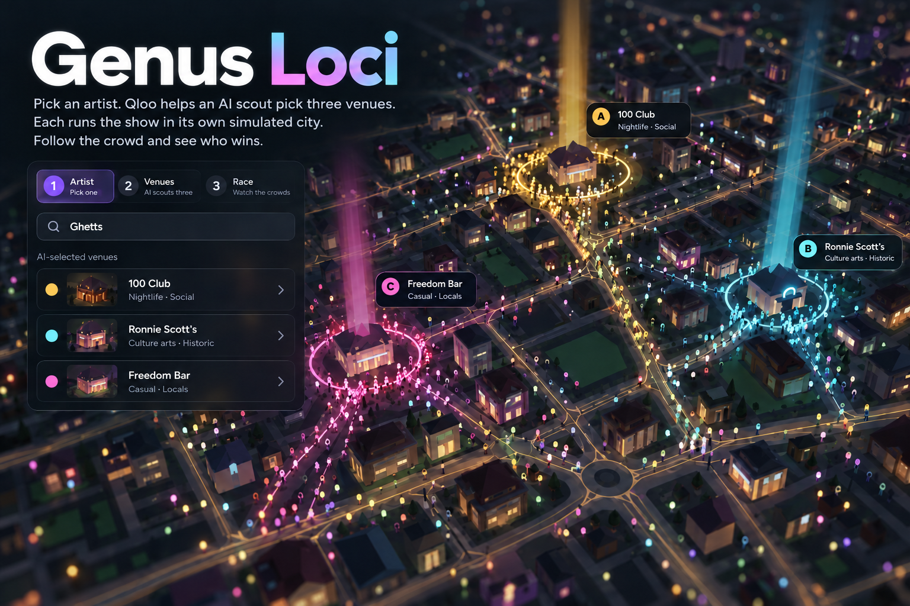

# Genus Loci



**Which venue would draw the biggest crowd for this artist? Pick an artist, let an AI scout choose three venues with Qloo, and watch them race in a simulated city.**

Pick an artist. A scout agent uses Qloo's taste data to choose three of the city's venues. Each venue then hosts the artist in its own copy of the same simulated city, from the same moment and with the same luck, night by night. One dot per visit walks the real streets to each venue in its colour, and the tallies climb. The result names the winner, checks it against two more futures with different luck, and shows what the event did to the venue's usual nights and its neighbours.

Qloo supplies the venues, taste tags, artist affinities and geographic heatmaps. The residents, their nights out and the visit counts are simulation, not observed people or ticket sales.

**Live demo:** [genusloci-culture-simulator.vercel.app](https://genusloci-culture-simulator.vercel.app/)

## The experience

1. **Artist.** While you choose, the city runs live: residents go out, and taste scenes form and spread. Pick a suggested artist or type any name. An artist the city doesn't know is looked up live in Qloo, and their fans' tastes stand in for them.
2. **Venues A, B, C.** The scout agent picks three of the city's venues and says why. It asks Qloo live which venues the artist's fans like when the city's stored data is thin. They appear on the map in three colours. Each venue's regulars glow in its colour and everyone else dims. Swap a venue, or choose how many nights (races start on a Friday).
3. **Race.** Each night, one bright dot per visit walks to each venue in its colour; earlier nights' visitors stay faintly lit. Play, Pause and speed are yours.
4. **Result.** The result names who drew the most and whether it also won the other futures, with ranges. It also shows usual nights versus with the event, and visits taken from venues nearby.
5. **Tweak.** Go back with the step tabs to change the artist, venues or nights and race again, or watch the same race again.

Hover or click any venue for its status (a red ring means it's struggling) and its regulars by taste scene. **Taste scenes** lists the city's scenes and lights them up on the map.

The scout agent looks the artist up in Qloo, asks Qloo live which of the city's venues the artist's fans like when the stored data is thin, reads the venues' Qloo tags and commits to three venues with a reason for each. For arena-level artists it says the area's venues are far smaller. When the race starts, it writes up why the winner won from the race's numbers. It needs a language-model key (Gemini, then Groq). Without one, the race still runs with the three best matches and no write-up.

## Why Qloo matters

| Qloo-derived input | Role in the model |
| --- | --- |
| Places, locations, kinds and taste tags | Venue catalogue, venue profiles and scene starting points |
| Artist recommendations and cultural affinities | Taste graph used in venue matching and adoption probabilities |
| Heatmaps | Geographic seeding; separate held-out maps support a limited spatial diagnostic |
| Artist affinities to venues | Ranking the city's venues for the scout agent |
| Live artist lookup | Outside artists: who their fans also like, as the event's taste |
| Live search and located place insights | The scout agent's artist lookups and live venue ranking |

Removing Qloo would leave a functioning generic simulator, but remove the basis for its city-specific cultural relationships. Qloo provides cultural inputs; it does not validate the authored dynamics. We have not demonstrated superiority over an LLM-only baseline or real-world forecasting accuracy.

## Architecture

- **Simulation:** deterministic TypeScript in a Web Worker. Sparse tastes, outings, social exposure, drift/decay, venue health, scene clustering and lineage. The venue race steps a no-event baseline and one forked future per venue in lock-step from the same seed, so the race on screen is exactly future 1 of the forecast.
- **Scout agent:** Vercel AI SDK tool calling on the server, with Qloo tools (artist taste, live venue ranking, venue tags) and a final choice the browser validates against the city's venues. It never produces the race numbers.
- **Interface:** Next.js 16, React 19, React Three Fiber and Three.js. Real venue landmarks and OpenStreetMap streets; residents walk street routes to their venue.
- **Verification:** Vitest, ESLint and production TypeScript builds. Current task evidence and known limits live in [current state](docs/current-state.md).

## Run locally

Use Node 24 and pnpm 10.30.3.

```bash
pnpm install
cp .env.example .env.local
# Add QLOO_API_KEY to build a Qloo-grounded world.
# Optionally add GOOGLE_GENERATIVE_AI_API_KEY and/or GROQ_API_KEY for the scout agent.
pnpm build:world london
pnpm dev
```

Open localhost:3000. City builds write ignored `.cache/worlds/<city>.world.json`; they use live Qloo calls and cache matching requests. Costs depend on cache state and available signals. Other supported city slugs are `singapore` and `newyork` (see `src/geo/cities.ts` for the registry).

Without a built world or configured private world store, the app uses an explicitly identified synthetic fallback. That fallback is useful for setup/testing but does not demonstrate Qloo grounding. Without LLM credentials, the race works with the three best Qloo fits; only the agent's picks and write-up are missing. Provider configuration does not guarantee quota or availability.

```bash
pnpm test
pnpm lint
pnpm build
```

Externally hosted builds need the private world store configured and optional server-side provider credentials; see [.env.example](.env.example), [architecture](docs/architecture.md) and [world-build operations](docs/on-demand-world-builds.md). Never commit credentials, cached Qloo responses or built world files.

## Scope and evidence

The venue race compares simulated visits under authored rules and Qloo-derived inputs. It is not a ticket forecast, a check of real capacity or availability, or a validated planning tool. The three-future check shows how much luck matters within the model; it is not a calibrated confidence interval. Venues still open and struggle or close on their own; rent changes, manual closures, event booking and resident interviews remain in the engine but are not part of the interface.

## Data and licences

- Code: [MIT](LICENSE), copyright Jethro Tan.
- Map data: [OpenStreetMap contributors](https://www.openstreetmap.org/copyright), ODbL; see `public/geo`.
- Cultural data: [Qloo](https://www.qloo.com), used under the applicable hackathon terms; raw response caches and generated worlds stay out of Git.

Built for the [Qloo Agentic Hackathon](https://qloo.devpost.com/), started 9 October 2026.
