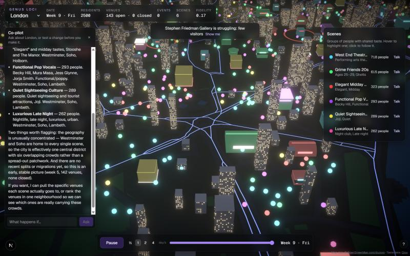

# Genus Loci

**A chat-first cultural ecology laboratory: explore how tastes, encounters and shared places interact in an agent-based model grounded in Qloo.**

Thousands of synthetic residents carry weighted cultural interests. They visit catalogue venues, influence one another and form model scenes. Ask the experiment chat to inspect the city, compare a hypothetical closure/opening/rent change against a no-change future, or explicitly apply an intervention. Supported local commands require no LLM; optional AI helps with broader questions. Outcomes describe the authored model, not observed fans or validated ticket forecasts. Start with the [current walkthrough](docs/chat-lab-walkthrough.md).

**Live demo:** https://genusloci-culture-simulator.vercel.app (London, Singapore, New York)



Built for the [Qloo Agentic Hackathon](https://qloo.devpost.com/), "Agents, but with taste".

## Who it's for

- **Learners and technically curious visitors:** investigate how individual rules can produce group patterns, inspect assumptions and compare reproducible model experiments.
- **ALife/agent-based modelling enthusiasts and portfolio reviewers:** explore deterministic simulation, cultural data grounding, tool orchestration and the limits of causal claims. Practitioner decision support remains unvalidated.

## What you can do

The chatbot is the current entry point. The inventory below describes retained engine capabilities; earlier standalone workspaces are hidden compatibility code. See the walkthrough for which commands are locally supported. Arbitrary language, every legacy action and LLM equivalence are not promised.

- **Watch a real city:** real streets from OpenStreetMap and about 140 real venues from Qloo. Residents walk out each night and home again, and scenes appear in the legend with plain names generated from their tastes.
- **Change it:** open a venue (the best-fitting real place for that spot), throw an event with a real artist, or close a venue. Effects ripple through the city.
- **Scout a location:** compare candidate spots for a headliner. Each spot is simulated a few weeks ahead next to a no-event baseline, over several seeded runs.
- **Ask the co-pilot:** *"What happens if the busiest club closes?"* It reads the city, ranks venues and runs a what-if. Each what-if repeats a with-change and a no-change copy of the city four times, and the co-pilot reports which effects are clear and which are too small to call. It can also make the change when asked, and look things up in Qloo.
- **Talk to a resident:** interview a typical member of any scene. They speak only from their own simulated tastes.

## How it uses Qloo

Qloo data drives the model, not just its labels:

| Qloo | Used for |
|---|---|
| Place insights within the city (one union-of-tags query per venue kind) | The venues: location, kind, popularity and taste tags |
| Artist recommendations for each anchor venue's crowd | Artists in residents' tastes, event headliners, venue–artist and artist–artist affinities |
| Place and music tags | Taste genes, plus the affinities that drive who adopts what and how tastes drift |
| Heatmaps | One per scene seeds where its residents live. A **different, held-out** one per scene measures **fidelity**, which rises as the city runs (after 60 weeks: London about 0.22, New York 0.31, Singapore 0.11) |
| Search and tag affinities (live) | Co-pilot lookups, capped per question |

Qloo responses are never committed to this repository (Qloo terms). City worlds are built with a CLI, cached locally, and served by the app from a private store.

## How it works

- **Simulation** (TypeScript, in a Web Worker). Residents have sparse taste genomes over Qloo entities. Each tick (one day):
  - residents choose a venue by taste, distance and friends;
  - they're exposed to the venue's and the crowd's tastes, and adopt along Qloo affinities;
  - tastes drift and decay;
  - venues' health follows their weekly occupancy;
  - scenes are tracked with warm-started spherical k-means and lineages;
  - under-served scenes can get new venues.

  It's deterministic, with exact rewind and fork.
- **Rendering:** a React Three Fiber night diorama, with OSM streets, instanced buildings, landmarks per venue kind, crowds walking the street graph, and post-processed effects for openings, closures and events.
- **Agents:** the Vercel AI SDK, provider-agnostic. DeepSeek V4 Flash is primary, with fallbacks through Groq, Cerebras, OpenRouter and Gemini. The co-pilot's city tools run in the browser against the simulation worker; Qloo tools run on the server.
- **Stack:** Next.js 16, React 19, Three.js, zod, Vitest (about 380 tests), deployed on Vercel.

More detail: [docs/architecture.md](docs/architecture.md), [docs/qloo-notes.md](docs/qloo-notes.md), [docs/decisions](docs/decisions).

## Running it locally

```bash
pnpm install
cp .env.example .env.local   # then add QLOO_API_KEY and DEEPSEEK_API_KEY
pnpm build:world london      # builds a city from Qloo into .cache/worlds (about 60–80 calls; reruns are free)
pnpm dev                     # http://localhost:3000
```

Without a Qloo world the game falls back to a synthetic population over the real streets. Without an LLM key it still runs, but the co-pilot, scene names and interviews are offline.

Other commands: `pnpm test`, `pnpm lint`, `pnpm calibrate --world=<city>`, `pnpm build:geo <city>`, `pnpm qloo:smoke`, `pnpm upload:worlds`.

## Data and licences

- Code: [MIT](LICENSE).
- Map data © [OpenStreetMap](https://www.openstreetmap.org/copyright) contributors, ODbL 1.0 (`public/geo`).
- Taste data from [Qloo](https://www.qloo.com), used under the hackathon terms and not redistributed here.
